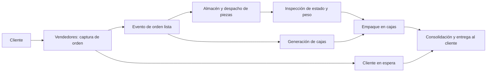

<div align="center">

# 📦 El Triunfo — distribución de repuestos

**Simulación del ciclo completo: pedido, inventario, inspección, empaque y entrega**


[Descripción](#descripción) · [Flujo](#flujo-operativo) · [Datos](#datos-de-entrada) · [Reproducción](#reproducción)

</div>

---


## Descripción

Modelo de una distribuidora de repuestos desarrollado para la **Práctica 2 de Modelación y Simulación 1, grupo 1**. Conecta la atención al cliente con el movimiento físico de las piezas en bodega, incluyendo control de calidad, consolidación de cajas y entrega del pedido.

El interés técnico está en **sincronizar flujos que avanzan a ritmos diferentes**: clientes en espera, generación de repuestos, inspecciones, cajas y reposición de inventario. La coordinación usa eventos, estados y monitores de Simio.

## Flujo operativo



## Decisiones de modelado

| Mecanismo | Problema que representa |
| --- | --- |
| Cola y vendedores | Atención de pedidos antes de iniciar el flujo físico de la orden. |
| Evento `Evento_Orden_Lista` | Coordinación entre la atención al cliente, las piezas y las cajas. |
| Inspecciones | Control de estado y peso, con probabilidades definidas en tablas de entrada. |
| Lotes de empaque | Cajas de hasta diez piezas, ajustando el último lote a las piezas pendientes. |
| `Combiner` de entrega | Reunión del pedido preparado con el cliente correspondiente. |
| Monitores de inventario | Activación de procesos de reposición en bodega. |
| Variables financieras | Seguimiento de ingresos, costos y ganancias del caso simulado. |

El [manual técnico](contexto.md) desarrolla las expresiones de empaque, las conexiones de objetos y los estados que coordinan estos procesos.

## Datos de entrada

| Archivo | Función dentro del caso |
| --- | --- |
| [Costos.xlsx](Costos.xlsx) | Parámetros de costos. |
| [Precios.xlsx](Precios.xlsx) | Parámetros de precios e ingresos. |
| [ProbabilidadesInspeccion.xlsx](ProbabilidadesInspeccion.xlsx) | Distribuciones o probabilidades utilizadas en inspección. |
| [ProbabilidadesProductos.xlsx](ProbabilidadesProductos.xlsx) | Mezcla o selección de productos. |

Mantener estas hojas junto al modelo y revisar sus enlaces de importación en Simio antes de ejecutar. Las rutas del equipo de origen pueden necesitar adaptación.

## Reproducción

1. Abrir `[MyS1]Modelo_G1.spfx` en una instalación compatible de Simio de escritorio.
2. Revisar las hojas de entrada y contrastar los parámetros con el manual.
3. Verificar unidades por proceso: el caso combina operaciones expresadas en **minutos y segundos**. Esa diferencia es relevante al estudiar la acumulación antes de inspección.
4. Revisar el horizonte, los estados de inventario, los lotes y la sincronización de clientes/piezas/cajas.
5. Ejecutar la corrida y observar colas, inspecciones, empaque y entrega; exportar una nueva traza con sus parámetros y semilla.

## Cómo interpretar la evidencia

La [traza entregada](%5BMyS1%5DModelo_G1_Model_trace.csv) permite inspeccionar eventos de la ejecución. Para evaluar el sistema se pueden contrastar piezas despachadas e inspeccionadas, pedidos preparados, acumulación en buffers y evolución del inventario.

El repositorio no incluye un `ResultsSummary.csv` separado. Las conclusiones numéricas del manual corresponden a la entrega documentada; una comparación nueva requiere ejecutar el modelo y registrar sus resultados.

## Archivos principales

```text
[MyS1]Modelo_G1.spfx          Modelo editable en Simio
[MyS1]Modelo_G1.backup        Respaldo de Simio
[MyS1]Modelo_G1_Model_trace.csv
contexto.md                  Configuración y lógica del caso
*.xlsx                       Tablas de entrada
```

[Abrir manual técnico](contexto.md) · [Acceder al modelo](%5BMyS1%5DModelo_G1.spfx)

## Equipo y verificación

Trabajo colaborativo del **grupo 1**. El historial conserva los aportes al modelo y su documentación. La revisión documental valida las referencias del repositorio; la ejecución de objetos, eventos y monitores debe comprobarse en Simio.
